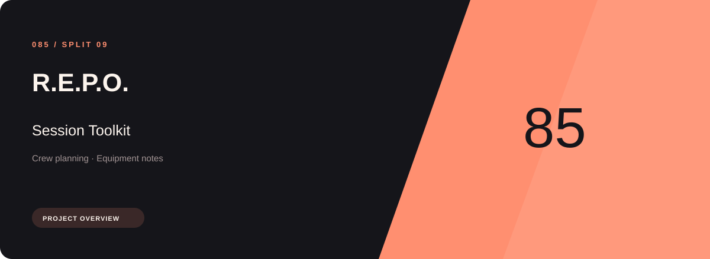
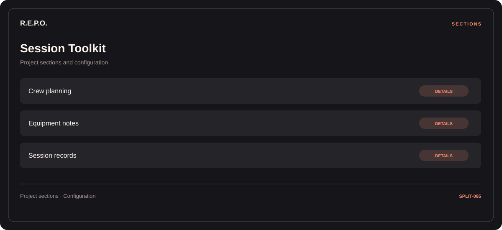

# 🎮 R.E.P.O. Session Toolkit

**Crew planning · Equipment notes · Session records**

## ⚡ Features

R.E.P.O. Session Toolkit brings crew planning and equipment notes into one section-based interface. Session records provides the third part of the workflow.

### ⚙️ Crew planning

Character or team groups presented with the context needed to organize a session.

### 🧩 Equipment notes

Equipment categories and the associated selection or configuration options.

### ⌨️ Session records

Session and activity information grouped by the task or context it belongs to.

## 🖥️ Project navigation

## 📥 Download

The button and cover open the project's download page. Use the information supplied with the downloaded package for installation and release-specific requirements.

## 📚 Project documentation

- [Feature reference](docs/FEATURES.md)
- [Download information](docs/DOWNLOAD.md)
- [Project page](index.html)

---

R.E.P.O. Session Toolkit · Program documentation and download information.
                                                                                                    